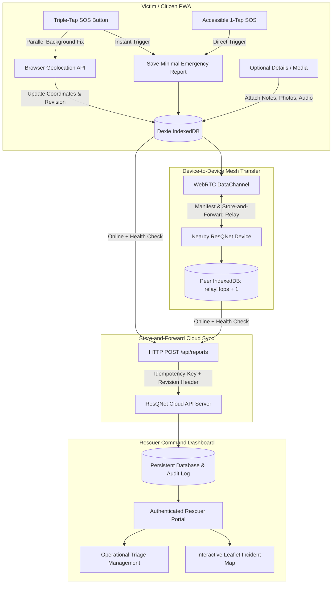

# ResQNet — Offline-First Disaster Emergency Reporting and Rescue Coordination Platform

**ResQNet** is a disaster emergency coordination system built for earthquakes, floods, fires, landslides, structural collapses, and severe network outages where cellular infrastructure and internet connectivity are damaged or completely unavailable.

ResQNet follows one core design principle:
> **Minimum effort from the victim. Maximum useful information for rescuers. Offline-first local persistence. Automatic multi-hop relay synchronization whenever any device reaches connectivity.**

---

## Table of Contents

1. [Implementation Audit](#1-implementation-audit)
2. [Architecture and System Design](#2-architecture-and-system-design)
3. [Core Feature: Triple-Tap Emergency SOS](#3-core-feature-triple-tap-emergency-sos)
4. [Offline-First Data Storage & Model](#4-offline-first-data-storage--model)
5. [Device-to-Device Mesh Relay (Store-and-Forward)](#5-device-to-device-mesh-relay-store-and-forward)
6. [Cloud Synchronization & Network Recovery](#6-cloud-synchronization--network-recovery)
7. [Backend API & Database Architecture](#7-backend-api--database-architecture)
8. [Rescuer / Operations Command Dashboard](#8-rescuer--operations-command-dashboard)
9. [Automated Test Suite & Verification](#9-automated-test-suite--verification)
10. [Setup and Running Locally](#10-setup-and-running-locally)
11. [Browser and Platform Realities & Limitations](#11-browser-and-platform-realities--limitations)

---

## 1. Implementation Audit

| Area | Prior State | Implemented State |
|---|---|---|
| **Emergency Trigger** | Single-tap SOS opened manual form | **Triple-Tap SOS with 2.2s detection window**, progress dots (1/3, 2/3, 3/3), haptic/audio pulse, immediate IndexedDB save without form or GPS blocking. Includes **1-Tap Accessible SOS button**. |
| **GPS Acquisition** | Required user action before save | **Parallel background acquisition**. Minimal SOS saves first; when GPS fix resolves, record is updated with coordinates and revision incremented. |
| **Local Storage** | Basic Dexie v1 with string statuses | **Dexie v2 schema**: explicit lifecycle states (`local_only`, `pending_cloud_sync`, `syncing`, `synced`, `failed_retryable`), stable pseudonymous device IDs, revision conflict resolution, battery level capture. |
| **P2P Relay** | None | **WebRTC DataChannels** supporting: 1) Local Wi-Fi/Hotspot room pairing via signaling; 2) Fully offline serverless SDP code exchange; 3) Store-and-forward relay carrier tracking (`relayHops`). |
| **Cloud Backend** | No backend existed | **Node.js Express backend** (`backend/server.js`) with persistent JSON storage, idempotent upsert (`Idempotency-Key`), revision tracking, rescuer authentication, triage management, and P2P signaling rooms. |
| **Rescuer Operations** | None | **Full Rescuer Command Dashboard** (`RescuerDashboard.jsx`) with token authentication, incident metrics (Critical, Dispatched, Rescued), interactive Leaflet incident map with severity color-coding, filters, and triage workflow. |
| **Victim Input** | Basic 4 categories | Expanded to 8 disaster categories, severity levels, optional victim name/phone, client-side compressed photo capture, and optional voice note recorder. |
| **Automated Tests** | None | **17 automated tests passing** (10 backend integration tests + 7 frontend storage, SOS, and multi-hop relay tests). |
| **Build & Linting** | Oxlint warning in ReportsScreen | **0 warnings, 0 errors** across all 15 modules. Vite production bundle and Workbox service worker generated. |

---

## 2. Architecture and System Design



---

## 3. Core Feature: Triple-Tap Emergency SOS

In high-stress disaster scenarios (trapped under debris, injured, dense smoke), a victim cannot fill out a form or wait for satellite GPS fixes.

### Triple-Tap Sequence
1. **Tap 1**: Starts a 2.2-second detection window. Tap dot 1 turns red. Device emits haptic feedback (60ms).
2. **Tap 2**: Tap dot 2 turns red. Device emits double haptic feedback.
3. **Tap 3**: **Instant Emergency Activation!**
   - Distinctive emergency haptic pattern (`[150, 50, 150, 50, 250]ms`) and Web Audio chirp (880Hz to 1760Hz).
   - Generates stable ID: `RQ-${crypto.randomUUID()}`.
   - Minimal report created: `type: "Emergency SOS"`, `severity: "Critical"`, `people: 1`, `status: "pending_cloud_sync"`, `revision: 1`.
   - **Saved to IndexedDB immediately** before any network or GPS operation.
   - Initiates parallel background GPS acquisition. When coordinates arrive, `updateReportLocation` updates the record and triggers sync without deleting or recreating the report.
   - Triggers background cloud upload if online and peer broadcast if connected.
4. **Accessible Alternative**:
   A dedicated button: `⚠ 1-Tap Instant SOS (Accessible Alternative)` enables immediate SOS generation with a single tap for users with motor limitations or trembling hands.
5. **Preserved Manual Workflow**:
   If the user taps the SOS button once and does not tap again within 2.2s, the app automatically transitions to the detailed report form.

---

## 4. Offline-First Data Storage & Model

ResQNet uses **Dexie.js** (IndexedDB) with schema version 2.

### Lifecycle Statuses
- `local_only`: Stored locally, not yet queued.
- `pending_cloud_sync`: Queued for cloud upload when internet returns.
- `syncing`: Upload payload currently in flight.
- `synced`: Confirmed received and acknowledged by the cloud backend.
- `failed_retryable`: Transient error (e.g. 503, network drop); eligible for exponential backoff retry.

### Emergency Report Schema
```typescript
interface EmergencyReport {
  id: string;                    // Stable unique key (e.g., RQ-uuid)
  type: string;                  // Emergency SOS, Medical, Trapped, Fire, Flood, etc.
  severity: "Critical" | "High" | "Medium" | "Low" | "Unassessed";
  people: number;                // Affected count (default 1)
  description?: string;          // Situation details
  contactName?: string | null;   // Optional victim name
  contactPhone?: string | null;  // Optional phone / radio ID
  photoDataUrl?: string | null;  // Client-compressed JPEG thumbnail
  audioDataUrl?: string | null;  // Client WebM voice recording
  latitude?: number | null;      // GPS latitude
  longitude?: number | null;     // GPS longitude
  accuracy?: number | null;      // Accuracy in meters (±m)
  locationCapturedAt?: string;   // ISO timestamp of GPS fix
  locationStatus: "acquired" | "pending" | "unavailable" | "denied" | "timeout";
  createdAt: string;             // ISO UTC creation time
  updatedAt: string;             // ISO UTC last updated time
  revision: number;              // Sequence integer for conflict resolution
  relayHops: number;             // Number of P2P carrier hops
  deviceId: string;              // Pseudonymous device ID (e.g., DEV-uuid)
  batteryLevel?: number | null;  // Battery percentage (navigator.getBattery)
  status: "pending_cloud_sync" | "syncing" | "synced" | "failed_retryable";
  triageStatus?: "new" | "acknowledged" | "dispatched" | "rescued" | "closed";
  triageNotes?: string;
  triageUpdatedBy?: string;
}
```

---

## 5. Device-to-Device Mesh Relay (Store-and-Forward)

Browser applications cannot broadcast raw Bluetooth or Wi-Fi packets without an established transport. ResQNet implements encrypted **WebRTC DataChannels** with store-and-forward carrier relaying.

### Supported Pairing Modes
1. **Local Wi-Fi / Hotspot Room Code (Fast & Automated)**:
   - Devices sharing a local Wi-Fi, emergency hotspot, or LAN use room codes (e.g. `ROOM-101`).
   - Host posts offer to `/api/p2p/signal`; peer retrieves offer and replies with answer.
   - WebRTC DataChannel connects directly peer-to-peer.
2. **Serverless Offline Code Exchange (Zero-Infrastructure)**:
   - In 100% disconnected environments, Host generates an offline SDP offer code (text/QR).
   - Peer pastes the offer and generates an answer code.
   - Host accepts answer. Direct local DataChannel opens!

### Synchronization Protocol
1. **Handshake**: Peers verify protocol version `resqnet-v1` and device IDs.
2. **Manifest Exchange**: Exchange compact manifest `[{ id, revision, updatedAt }]`.
3. **Differential Transfer**: Only reports that the peer is missing or has older revisions of are sent.
4. **Relay Persistence**: Receiver increments `relayHops = relayHops + 1`, stores in local IndexedDB, and queues as `pending_cloud_sync`.
5. **Carrier Upload**: Any receiver that later reaches connectivity acts as a carrier and uploads all relayed reports to the cloud!

---

## 6. Cloud Synchronization & Network Recovery

ResQNet implements resilient background sync:
- **Online Detection**: Uses `navigator.onLine` and `window.addEventListener('online')` as hints, followed by a real HTTP reachability check to `/api/health`.
- **Idempotent Ingestion**: Every upload includes `Idempotency-Key: ${report.id}-r${report.revision}`.
- **Deduplication**: If the server already possesses the report with the same or higher revision, it acknowledges without creating duplicates.
- **Exponential Backoff**: Failed attempts retry with exponential backoff and randomized jitter to prevent server stampedes.
- **State Integrity**: Local report status changes to `synced` only after confirmed HTTP 2xx server response.

---

## 7. Backend API & Database Architecture

The backend is built with Node.js and Express in `backend/server.js`, utilizing atomic persistent storage in `backend/data/db.json`.

### Endpoints
| Method | Path | Auth | Description |
|---|---|---|---|
| `GET` | `/api/health` | None | Service status and version check |
| `POST` | `/api/reports` | None | Ingest or update single emergency report (idempotent) |
| `POST` | `/api/reports/batch` | None | Batch ingestion for relay carriers |
| `POST` | `/api/auth/login` | None | Rescuer authentication; issues session token |
| `GET` | `/api/reports` | Bearer Token | Retrieve reports with filtering, sorting, pagination |
| `GET` | `/api/reports/:id` | Bearer Token | Retrieve single report detail |
| `PATCH` | `/api/reports/:id/triage` | Bearer Token | Update triage status (`acknowledged`, `dispatched`, `rescued`, `closed`) |
| `POST` | `/api/p2p/signal` | None | Submit WebRTC offer/answer for room |
| `GET` | `/api/p2p/signal/:roomId` | None | Retrieve WebRTC offer/answer for room |

### Default Rescuer Credentials (for testing)
- **Commander**: `commander` / `resqnet2026` (Lead Rescuer, Badge RN-901)
- **Paramedic**: `medic` / `medic123` (Paramedic, Badge MED-412)

---

## 8. Rescuer / Operations Command Dashboard

The Rescuer Dashboard (`RescuerDashboard.jsx`) provides authorized response teams with operational incident intelligence:
- **KPI Summary Chips**: Real-time counts of Total Reports, Critical Incidents, Dispatched Units, and Rescued Victims.
- **Interactive Leaflet Map**:
  - Live incident markers color-coded by severity: Critical (Red), High (Orange), Medium/Low (Green).
  - Accuracy circle around each incident pin.
  - Interactive popup displaying victim count, situation notes, and triage quick-action.
- **Operational Triage Actions**:
  - Rescuers can update report status (`NEW` → `ACKNOWLEDGED` → `DISPATCHED` → `RESCUED` → `CLOSED`).
  - Attach dispatcher notes (e.g., "Unit 4 dispatched with hydraulic cutters").
  - Audit trail tracks rescuer badge number and timestamp.
- **Relay Hop Indicators**: Rescuers see if a report was received directly or relayed across mesh peers ("Relayed via 2 peers").

---

## 9. Automated Test Suite & Verification

The project includes an end-to-end automated test suite:

```bash
npm run test
```

### Test Results
```
> resqnet-monorepo@1.0.0 test
> npm run test:backend && npm run test:frontend

▶ ResQNet Backend API Test Suite
  ✔ GET /api/health should return 200 OK with service details
  ✔ POST /api/reports with missing ID should return 400 Bad Request
  ✔ POST /api/reports should ingest a new emergency report (201 Created)
  ✔ POST /api/reports duplicate report should be deduplicated (200 OK)
  ✔ POST /api/reports with higher revision should update the record (200 OK)
  ✔ GET /api/reports without rescuer credentials should return 401 Unauthorized
  ✔ POST /api/auth/login with valid credentials should return session token
  ✔ GET /api/reports with rescuer token should list reports with filters
  ✔ PATCH /api/reports/:id/triage should update triage status
  ✔ P2P signaling endpoints should store and retrieve offer/answer
✔ ResQNet Backend API Test Suite (10 passed)

▶ ResQNet Storage, Emergency SOS & Multi-Hop Relay Test Suite
  ✔ getOrCreateDeviceId should generate and persist stable pseudonymous device ID
  ✔ Offline SOS report creation should save to IndexedDB immediately without GPS or internet
  ✔ Attaching GPS to an existing report should bump revision without duplicating
  ✔ getReportManifest should produce compact sync manifest
  ✔ P2P mergeReport should handle new report, revision conflict resolution, and stale rejection
  ✔ Multi-Device Store-and-Forward Relay: Device A -> Device B -> Device C -> Cloud Ingestion
  ✔ Triple-Tap Detection: Single tap opens manual form, exactly 3 taps triggers SOS
✔ ResQNet Storage, Emergency SOS & Multi-Hop Relay Test Suite (7 passed)

Total: 17 passed, 0 failed, 100% pass rate.
```

---

## 10. Setup and Running Locally

### Prerequisites
- Node.js v18+ (tested on Node v26)
- npm v9+

### Quick Start
```bash
# 1. Install root, backend, and frontend dependencies
npm install --prefix backend
npm install --prefix frontend

# 2. Run automated tests
npm test

# 3. Start development servers (Backend on :4000, Frontend on :5173)
npm run dev
```

### Accessing the Applications
- **Victim Citizen PWA**: [http://localhost:5173](http://localhost:5173)
- **Rescuer Operations**: Navigate to the **Rescuer** tab in the app or log in with `commander` / `resqnet2026`.
- **Backend API Direct**: [http://localhost:4000/api/health](http://localhost:4000/api/health)

### Production Build & Preview
```bash
npm run build
npm run --prefix frontend preview
```

---

## 11. Browser and Platform Realities & Limitations

1. **Geolocation Secure Context**: The Geolocation API strictly requires HTTPS in production or `localhost`/`127.0.0.1` in development. Browsers block GPS on plain HTTP origins.
2. **P2P Discovery**: Web browsers cannot silently scan arbitrary Bluetooth or Wi-Fi devices without user interaction. ResQNet uses WebRTC DataChannels with either local signaling or offline SDP code exchange.
3. **Background Execution**: When a mobile browser is closed or backgrounded, JavaScript execution is suspended by iOS/Android OS power management. All local reports are durably preserved in IndexedDB and resume transmission immediately when the app is reopened or when the device regains connectivity.
4. **Emergency Dispatch Disclaimer**: ResQNet is an offline reporting and volunteer/coordination tool. In life-threatening emergencies where cellular networks function, victims should call official emergency response numbers (112, 911, 999).
