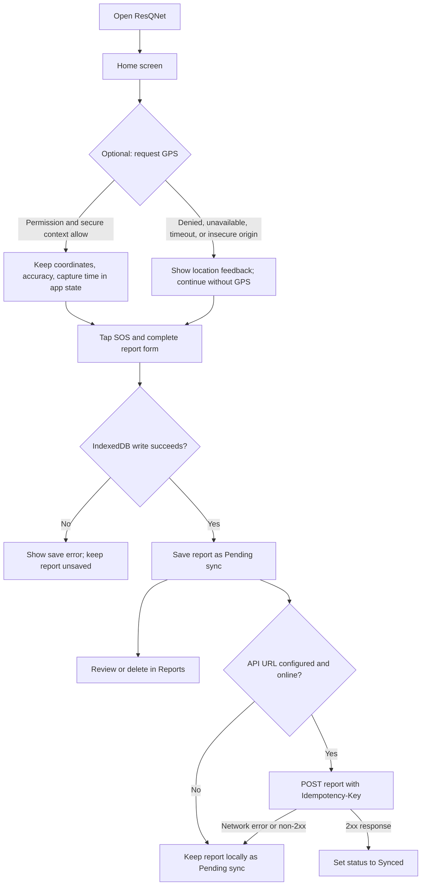
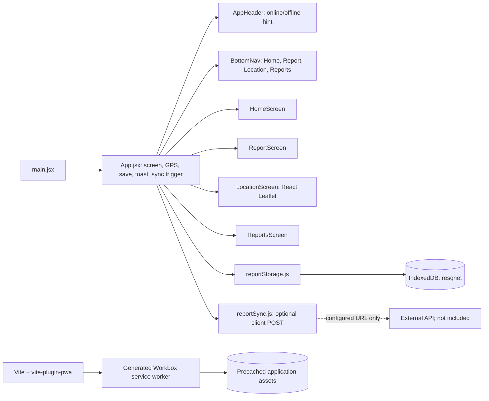

# ResQNet

**Offline-first emergency reporting PWA** built with React and Vite. ResQNet lets a person record an emergency report on the current device, optionally attach a GPS fix, and review saved reports even when the application shell is offline. It is a reporting tool, not an emergency dispatch service.

> **Emergency-use notice:** Saving a report does not contact emergency services or guarantee that responders will receive it. Use the appropriate local emergency number or official response channel when immediate assistance is required.

## Table of Contents

- [Project Overview](#project-overview)
- [Feature Status](#feature-status)
- [Technology Stack](#technology-stack)
- [How It Works](#how-it-works)
- [Architecture](#architecture)
- [Project Structure](#project-structure)
- [Installation and Local Setup](#installation-and-local-setup)
- [GPS, Offline Mode, and PWA Limitations](#gps-offline-mode-and-pwa-limitations)
- [Data Flow and Report Model](#data-flow-and-report-model)
- [Testing and Verification](#testing-and-verification)
- [Current Status and Roadmap](#current-status-and-roadmap)
- [Troubleshooting](#troubleshooting)
- [Contributing](#contributing)
- [Security, Privacy, and License](#security-privacy-and-license)

## Project Overview

Disaster-affected communities may have unreliable connectivity, limited power, and difficulty communicating precise incident information. ResQNet addresses one narrow part of that problem: it provides a mobile-oriented interface for collecting an emergency report locally first, so a temporary network outage does not prevent the user from recording the information on that device.

The current application is suitable as a prototype or local reporting interface for:

- People affected by an incident who need to record its type, severity, people affected, description, and optional location.
- Volunteers or coordinators who are using the same device to review locally saved reports.
- Developers evaluating an offline-first reporting workflow before connecting a real response service.

Reports are stored in the browser's IndexedDB database for the current origin and browser profile. A report is not visible to other devices or rescue teams unless a compatible API is configured and confirms receipt. No responder dashboard, emergency-service integration, user authentication, push/SMS alerting, or server-side storage is included in this repository.

## Feature Status

| Module / feature | Status | What the user can do and how it works | Implementation |
|---|---|---|---|
| Home and SOS entry | Implemented | View network status, optionally request location, and open the report form using the SOS button. SOS is navigation to the form; it does not place a call or dispatch help. | [`HomeScreen.jsx`](frontend/src/screens/HomeScreen.jsx), [`App.jsx`](frontend/src/App.jsx) |
| Emergency report form | Implemented | Choose Medical, Fire, Trapped, or Other; choose Low, Medium, or High severity; select 1–9 or 10+ people (10 is stored for 10+); enter an optional description up to 240 characters; submit to local storage. Inputs are disabled during save and reset only after success. | [`ReportScreen.jsx`](frontend/src/screens/ReportScreen.jsx), `handleSubmitReport` in [`App.jsx`](frontend/src/App.jsx) |
| Local report persistence | Implemented | Save, retrieve, and delete reports in the `resqnet` IndexedDB database through Dexie. On first access, the service attempts a one-time migration from the prior `localStorage` key `resqnet-reports`. | [`reportStorage.js`](frontend/src/services/reportStorage.js) |
| Location capture | Implemented, optional | Request a browser geolocation fix with high accuracy, 15-second timeout, and no cached fix. Latitude, longitude, accuracy, and the browser capture timestamp are held in app state; they are copied into a report when one is submitted. Reporting works without location. | `handleLocation` and `handleSubmitReport` in [`App.jsx`](frontend/src/App.jsx) |
| Location map and external map link | Implemented, online tiles | Show the captured coordinates as a marker with an accuracy radius on a Leaflet map. Provide a Google Maps link using those same coordinates. OpenStreetMap tiles are requested from the public tile URL and are not explicitly cached. | [`LocationScreen.jsx`](frontend/src/screens/LocationScreen.jsx) |
| Saved reports | Implemented | View reports ordered newest first, including ID, type, severity, description, people affected, creation time, location, accuracy, and local/sync status. Confirm before deleting. Load and delete failures are shown in the screen. | [`ReportsScreen.jsx`](frontend/src/screens/ReportsScreen.jsx), [`reportStorage.js`](frontend/src/services/reportStorage.js) |
| Temporary notifications | Implemented | Show success or error feedback in a dismissible toast for approximately one second. | `showMessage` and toast in [`App.jsx`](frontend/src/App.jsx) |
| Network indicator | Implemented, advisory only | The header listens to browser `online` and `offline` events and displays `navigator.onLine` state. This is a browser connectivity hint, not a check that a server is reachable. | [`AppHeader.jsx`](frontend/src/components/AppHeader.jsx) |
| Offline application shell | Configured | `vite-plugin-pwa` generates and registers a Workbox service worker for production builds. It precaches generated static assets matching the configured patterns and falls back to `index.html` for navigation. | [`vite.config.js`](frontend/vite.config.js), [`main.jsx`](frontend/src/main.jsx) |
| Optional API synchronization | Partially implemented; no backend included | When `VITE_RESQNET_API_URL` is set, the browser attempts pending-report POSTs at startup if online and again on the browser `online` event. A report changes to `Synced` only after a successful 2xx response. Otherwise it remains `Pending sync`. | [`reportSync.js`](frontend/src/services/reportSync.js), sync effect in [`App.jsx`](frontend/src/App.jsx) |
| Responsive UI and accessibility basics | Implemented; not formally audited | CSS adapts the mobile-first layout. Navigation has an accessible name and current-page state; report choices expose pressed state; status/error regions and visible keyboard focus styles are present. No formal WCAG audit is included. | [`App.css`](frontend/src/styles/App.css), [`index.css`](frontend/src/index.css), screen and component files under `frontend/src/` |

## Technology Stack

Versions below reflect the installed package tree checked in this workspace; `package.json` declares semver ranges rather than exact pins for most packages. The lockfile is `frontend/package-lock.json`.

| Technology | Installed / configured version | Purpose and use |
|---|---:|---|
| JavaScript, HTML, CSS | Browser platform | Application logic, document shell, and responsive styling. |
| React / React DOM | 19.3.1 installed (`^19.2.8` / `^19.2.8` declared) | UI rendering and component-local state; `App.jsx` owns selected screen, captured location, and submission state. |
| Vite | 8.3.4 installed (`^8.3.0` declared) | Development server, production bundling, and production preview. |
| `@vitejs/plugin-react` | 6.1.2 installed (`^6.1.1` declared) | React integration in Vite. |
| Dexie.js | 4.4.6 installed (`^4.4.6` declared) | IndexedDB wrapper for the `resqnet` database, reports, and migration metadata. |
| `leaflet` / `react-leaflet` | 1.9.4 / 5.0.0 installed | Interactive coordinate map, marker, accuracy circle, and popup. |
| `vite-plugin-pwa` / Workbox | 2.0.0 installed | Build-time manifest and service-worker generation; Workbox precache and navigation fallback. |
| Browser Geolocation API | Browser-provided | Optional position request from `navigator.geolocation.getCurrentPosition`. Requires permission and a secure context in supported browsers. |
| `oxlint` | 1.88.0 installed (`^1.81.0` declared) | Lint script (`npm run lint`). |
| `@vitejs/plugin-basic-ssl` | 2.3.0 installed | Declared as a development dependency, but not configured in `vite.config.js` and not used by the current scripts. |

There is no backend framework, cloud SDK, server database, authentication package, or test framework configured in the project.

## How It Works

1. The user opens the app and sees the Home screen. The header displays the browser's online/offline hint.
2. The user may request location from Home or the Location tab. If granted in a secure context, the browser fix is held in React state. If permission is denied, the fix is unavailable, or the request times out, the app displays a message; a report can still be submitted without GPS.
3. The user taps SOS to open the report form and enters the incident details.
4. On submission, the app generates an ID and ISO creation timestamp, adds the most recently captured location values if present, and writes the record to IndexedDB. A duplicate submit is blocked while the save is in progress. Storage failure is reported and does not navigate to the reports view as though the save succeeded.
5. The Reports tab reads IndexedDB and displays stored records. A successful write persists across a page refresh in the same browser profile. Deletion requires browser confirmation.
6. If a report API URL is configured, the app attempts synchronization at startup when online and when the browser emits `online`. A 2xx response marks that record `Synced`; failed requests leave it pending. There is no server in this repository.



## Architecture

The application is a single-page React frontend. `App.jsx` switches between four screens with local React state rather than URL routes. Data is persisted through an IndexedDB service; there is no centralized state library. Captured GPS is held in app memory and is copied into each submitted report, not stored as a separate location record.



### IndexedDB schema

The database is named `resqnet`, schema version 1. Dexie's declarations in `frontend/src/services/reportStorage.js` are:

- `reports`: primary key `id`; indexed fields `createdAt` and `status`.
- `metadata`: primary key `key`; used for the `legacy-reports-migrated` marker.

The service orders reports by `createdAt` descending, retrieves pending reports by `status`, and updates status and `syncedAt` after a confirmed successful API response.

### PWA configuration

`frontend/vite.config.js` configures `VitePWA` with `registerType: "autoUpdate"`, a standalone manifest, and generated Workbox service-worker behavior. The manifest uses app name `ResQNet - Emergency Response`, short name `ResQNet`, theme color `#176b4d`, start URL and scope `/`, and PNG icons at 192×192 and 512×512. Workbox precaches built assets matching `js`, `css`, `html`, `ico`, `png`, `svg`, and `woff2`; navigation requests fall back to `index.html`. The current setup does not define a runtime cache for map tiles or API responses.

## Project Structure

```text
ResQNet/
├── README.md
└── frontend/
    ├── .gitignore
    ├── .oxlintrc.json
    ├── README.md
    ├── index.html
    ├── package.json
    ├── package-lock.json
    ├── vite.config.js
    ├── public/
    │   ├── favicon.svg
    │   ├── icons.svg
    │   ├── ResQNet Emergency Response Emblem.png
    │   ├── pwa-192x192.png
    │   └── pwa-512x512.png
    └── src/
        ├── App.jsx
        ├── main.jsx
        ├── index.css
        ├── styles/
        │   └── App.css
        ├── components/
        │   ├── AppHeader.jsx
        │   └── BottomNav.jsx
        ├── screens/
        │   ├── HomeScreen.jsx
        │   ├── LocationScreen.jsx
        │   ├── ReportScreen.jsx
        │   └── ReportsScreen.jsx
        ├── services/
        │   ├── reportStorage.js
        │   └── reportSync.js
        └── assets/
            ├── hero.png
            ├── react.svg
            └── vite.svg
```

- `frontend/src/main.jsx` mounts the React app and global CSS.
- `frontend/src/App.jsx` coordinates screen selection, notifications, GPS capture, report creation, and optional sync triggers.
- `frontend/src/components/` contains the network-status header and bottom tab navigation.
- `frontend/src/screens/` contains the Home, Report, Location, and Reports screens.
- `frontend/src/services/` contains IndexedDB persistence/migration and the optional API sync client.
- `frontend/src/styles/App.css` contains the ResQNet UI styles; `index.css` contains global resets.
- `frontend/public/` holds favicon, brand emblem, and PWA icons. The repository currently has no screenshot files; the PNGs are brand/app icons, not screenshots.
- `frontend/.gitignore` excludes dependencies, build output, logs, and `*.local` files. Generated `dist/` and `node_modules/` are intentionally omitted from the tree.

## Installation and Local Setup

No repository URL is specified in this workspace, so these instructions assume you have opened or obtained the existing `ResQNet` directory.

### Prerequisites

- Node.js compatible with Vite 8 and npm. The environment used to verify this README had Node.js `v26.8.2` and npm `11.19.1`.
- A modern browser. GPS and service-worker features require a secure context (localhost is permitted for local testing; deployed sites should use HTTPS).

### Install and run

From the project root:

```sh
cd frontend
npm ci
npm run dev
```

Open the local URL printed by Vite. No environment variables are required for local report creation and IndexedDB storage.

### Build and preview the production PWA

```sh
cd frontend
npm run build
npm run preview
```

Vite prints the preview URL (by default, usually `http://localhost:4173/`). Load the preview while online and allow the generated service worker to install. Then reload once before testing offline behavior. The development server should not be used to conclude that production PWA precaching is working.

### Available package scripts

| Command | Effect |
|---|---|
| `npm run dev` | Start the Vite development server. |
| `npm run build` | Create the production bundle and generate the PWA manifest/service worker. |
| `npm run preview` | Serve the built bundle locally for production-like verification. |
| `npm run lint` | Run Oxlint. |

### Optional API configuration

To enable the existing client sync attempt, create `frontend/.env.local` and set:

```dotenv
VITE_RESQNET_API_URL=https://your-api.example
```

The client sends a `POST` request to the configured base URL followed by `/reports`, with the full report JSON and an `Idempotency-Key` header equal to the report ID. The API must accept cross-origin requests from the frontend origin and implement idempotent handling for that key. Any 2xx response is treated as confirmation; the client does not parse a server response body. No API implementation or URL is supplied by this project. Variables prefixed with `VITE_` are included in client-side build output; do not put secrets or private credentials in them.

## GPS, Offline Mode, and PWA Limitations

### GPS and maps

- Location is optional. The app uses `navigator.geolocation.getCurrentPosition` and requests high accuracy with a 15-second timeout.
- The user must grant browser permission. Browsers generally expose geolocation only in secure contexts, such as HTTPS or localhost. The app checks `window.isSecureContext` and does not bypass browser restrictions.
- GPS values live in application memory until report submission. They are not automatically restored after a full page reload unless already included in a saved report.
- A captured point and accuracy radius are displayed using React Leaflet. The map's OpenStreetMap tile requests require network access; tiles are not included in the Workbox precache or configured for runtime caching. The coordinate values and external Google Maps link remain available from a saved report when offline, but the external map itself requires connectivity.

### Offline and service worker

- Reports already written to IndexedDB remain available to the same browser profile on the same origin while offline, subject to browser storage availability and eviction policies.
- The production service worker precaches the app shell and matching static build assets after the app has been loaded online and the worker has installed. It does not cache all network resources.
- OpenStreetMap tiles, Google Maps, and the optional API require a working network. The app does not provide guaranteed delivery, background synchronization, or cross-device sharing.
- The header's Online/Offline label reflects `navigator.onLine`, which can report online even if a particular host is unreachable.

### Local versus synced reports

`Pending sync` means the report is saved locally and has not been confirmed by the configured API. `Synced` is set only after the client receives an HTTP 2xx response from the expected endpoint. The sync code runs in the foreground at startup and on an `online` event; it is not the Background Sync API. If no URL is configured, no upload is attempted. A report created after a sync pass waits for a later page startup or `online` event before upload is attempted. If an API attempt fails, the record remains pending and will be retried only on a later page startup or online event.

## Data Flow and Report Model

A newly submitted report has the following shape. Null location fields indicate that GPS was not captured; they are not guessed or fabricated.

```json
{
  "type": "Medical",
  "severity": "High",
  "people": 1,
  "description": "Needs assistance",
  "id": "RQ-2e1c7fa4-54b5-4cc1-a2c1-a4a1db000001",
  "latitude": null,
  "longitude": null,
  "accuracy": null,
  "locationCapturedAt": null,
  "createdAt": "2026-10-22T10:00:00.000Z",
  "status": "Pending sync"
}
```

| Field | Meaning |
|---|---|
| `id` | `RQ-` plus `crypto.randomUUID()` where available; otherwise a timestamp/random-string fallback. Used as IndexedDB primary key and API idempotency key. |
| `type` | One of `Medical`, `Fire`, `Trapped`, or `Other`. |
| `severity` | One of `Low`, `Medium`, or `High`. |
| `people` | Number selected by the form (1 through 9, or 10 for the `10+` option). |
| `description` | Trimmed optional text, limited to 240 characters by the form. |
| `latitude`, `longitude` | Coordinates from the captured browser geolocation fix, or `null`. |
| `accuracy` | Browser-reported horizontal accuracy in meters, or `null`. |
| `locationCapturedAt` | ISO timestamp derived from the Geolocation API position timestamp, or `null`. |
| `createdAt` | ISO timestamp when the report is created for saving. |
| `status` | Initially `Pending sync`; changes to `Synced` only after the optional API responds with 2xx. |
| `syncedAt` | Added to the stored record by the sync service after a successful 2xx response. Not present on a pending report. |

Records are stored under the `reports` object store in IndexedDB. The database also has a `metadata` store for the one-time legacy migration marker. Existing legacy records are read from `localStorage` key `resqnet-reports` on first database access when available.

## Testing and Verification

There is no automated test script or test suite in the current `package.json`. The following repository checks were run against the current implementation while preparing this README:

- `npm run build` — **passed** with Vite 8.3.4; Workbox generated the PWA manifest and service worker.
- `npm run lint` — completed with one warning, `react(set-state-in-effect)` in `frontend/src/screens/ReportsScreen.jsx` during asynchronous initial report loading. It is not a clean lint run.
- A production-preview browser smoke check previously confirmed that a created report remained visible after a page reload and that the service worker was active on localhost. This is a manual check, not an automated regression test.

### Manual test checklist

- [ ] Open the Report tab, submit a report without GPS, and verify a success toast and saved record.
- [ ] Reload the same origin and verify the report is still listed with `Pending sync`.
- [ ] Capture location with permission allowed; verify coordinates, accuracy circle, timestamp, and Google Maps URL.
- [ ] Deny location permission or test an unavailable position; verify the UI gives feedback and report submission still works without location.
- [ ] Confirm deletion, then verify the report disappears after a reload; cancel deletion and verify it remains.
- [ ] Build and preview production, load once online, then simulate offline and reload. Verify the app shell and saved reports open; expect map tiles and external links to be unavailable offline.
- [ ] Configure a test API that honors `Idempotency-Key`; verify only 2xx responses change status to `Synced`, while failed/network requests remain pending. No backend is included to run this check by default.
- [ ] Exercise storage errors in browser developer tools or a test browser profile where IndexedDB is unavailable/quota-limited; verify save/load errors are surfaced rather than reported as successful.
- [ ] Test PWA installation in a supported browser over localhost or HTTPS after a production build and service-worker installation.

## Current Status and Roadmap

### Implemented

- Four-screen mobile-oriented interface with Home, Report, Location, and Reports tabs.
- Optional browser GPS capture and a real Leaflet map of the captured coordinates.
- Local IndexedDB report storage, listing, migration from prior localStorage data, and confirmed deletion.
- Production PWA manifest, icons, generated service worker, and static-asset precaching.
- Optional configurable foreground sync client with pending/synced state.

### Partial or constrained

- Server synchronization depends on an external API contract; no server, endpoint deployment, API health check, auth, or response-body validation is part of this repository.
- Offline support covers the cached application shell and local records, not map tiles, external navigation, or guaranteed report delivery.
- Accessibility and responsive styling have useful foundations but have not received formal WCAG, assistive-technology, or broad device testing.
- The current lint command reports one React effect warning; there is no automated test suite.

### Not implemented; possible future work

- A real backend with durable server-side report storage and documented API lifecycle.
- Responder/coordinator dashboard, assignment, triage, and multi-device coordination.
- Authentication, authorization, audit history, and role management.
- Push notifications, SMS alerts, dispatch integrations, and delivery acknowledgements.
- Formal accessibility testing, automated component/integration tests, and end-to-end offline/GPS coverage.

These are future options, not current ResQNet capabilities.

## Troubleshooting

| Symptom | Likely cause and action |
|---|---|
| `npm` cannot find `package.json` | Commands must run in `frontend/`: `cd frontend` first. |
| GPS reports insecure context or is unavailable | Use `http://localhost` for local work or deploy through HTTPS; grant location permission in browser settings. A development LAN IP over plain HTTP may not be treated as secure. |
| Location denied or timed out | Check browser/site permissions and device location services, then retry. Report submission does not depend on GPS. |
| Map is blank or incomplete | The map requires network access to fetch OpenStreetMap tiles. Confirm connectivity; tiles are not cached offline. |
| Reports are missing | Check that the same browser profile and origin are being used and that IndexedDB is available. Browser data clearing, private browsing behavior, or storage eviction can remove local records. |
| App does not open offline | First load the production build online and allow the service worker to install, then reload. Development mode is not the production precache test. |
| A previous UI version persists | An installed service worker can serve an older cached application during updates. Reload after the worker updates; for development diagnosis, inspect/unregister the site worker and clear its Cache Storage in browser developer tools. |
| Report remains `Pending sync` | No API URL may be configured, the app may be offline, or the API request may have failed/non-2xx. Check the browser console/network panel and the API CORS/idempotency behavior. |

## Contributing

This workspace does not currently define a contribution guide or automated pull-request checks. For a focused contribution:

1. Keep changes scoped to the existing React/Vite frontend and preserve the offline-first behavior.
2. Run `cd frontend && npm ci && npm run lint && npm run build`.
3. Manually verify affected flows in the production preview, especially IndexedDB persistence, permission/error states, and offline behavior when relevant.
4. Describe API or data-model changes explicitly; never claim an upload or emergency dispatch succeeds without a real server confirmation.

## Security, Privacy, and License

- Reports and optional coordinates are sensitive personal information. Current records are stored locally in browser IndexedDB without application-level encryption or account access control. Anyone with access to the same browser profile may be able to inspect or clear them.
- If `VITE_RESQNET_API_URL` is configured, report data is sent to that service as JSON. Configure transport security, access controls, retention, consent, and privacy notices appropriate to the deployment. Never place API secrets in `VITE_` variables; they are client-visible.
- Do not rely on this prototype as the sole emergency communication channel. Local persistence does not mean responders have received a report.
- No `LICENSE` file is present in the inspected project. The project license has not yet been specified.
